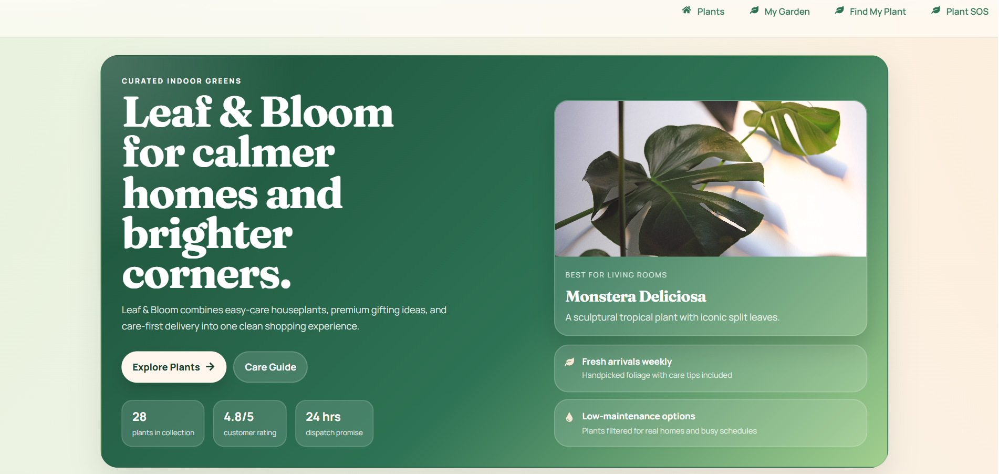
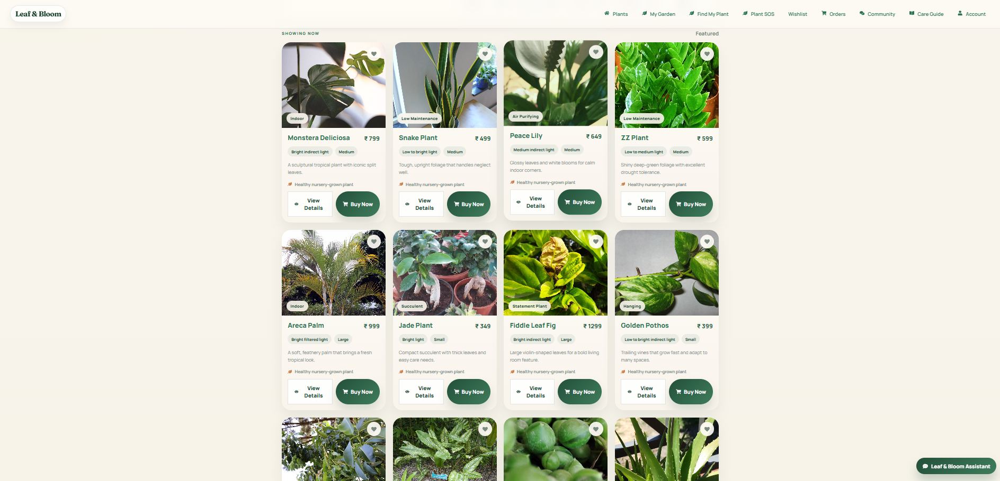
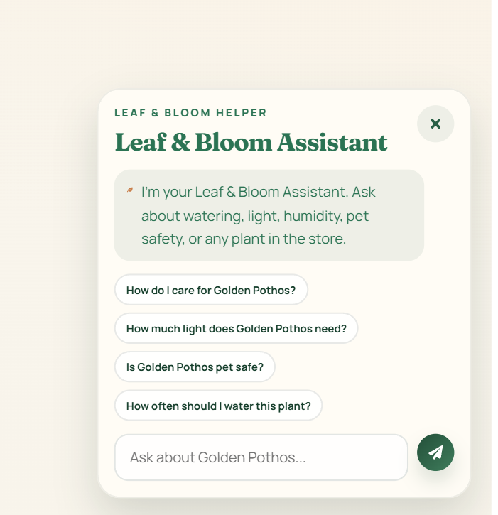

# 🌿 Leaf & Bloom

🌐 **Live Demo:** https://leaf-and-bloom.vercel.app

## 🖥️ Homepage Preview

## 🌱 Plant Listing Page

## 🤖 AI Plant Assistant

Explore the AI-powered plant assistant designed to help users with plant-related questions and guidance.

### Your Personal Plant Shopping & Care Platform

## 🚧 Project Status

**Currently in Development**

New features, improvements and testing are ongoing.

## 📌 About the Project

Leaf & Bloom is a plant e-commerce platform designed to help users discover, explore and purchase plants while learning how to care for them.

The platform provides a convenient shopping experience with plant discovery, shopping features and plant care information.

## ✨ Key Features

- 🌱 Browse and search for plants
- ❤️ Wishlist management
- 🛒 Shopping cart
- 📦 Checkout and order management
- 🌿 Plant care guidelines
- 👥 Plant lovers community
- 🤖 AI-powered plant assistant

## 💻 Technologies Used

- React.js
- JavaScript
- Node.js
- Express.js
- MongoDB
- REST APIs

## 👨‍💻 My Contribution

- Contributed to developing the Leaf & Bloom platform.
- Worked on frontend components and user interface.
- Implemented and integrated application features.
- Worked with MongoDB and REST API integration.

## 🎯 Project Objective

To make plant discovery and online plant shopping easier while helping users learn about plant care.

## 👤 Developer

**Nishanth Kumar R**

- GitHub: https://github.com/nishanthkumarr17-png
- LinkedIn: https://www.linkedin.com/in/nishanth-kumar-r-b2aa66405/
